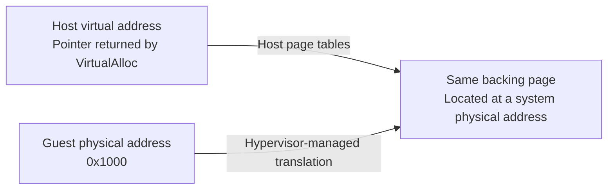

After writing [the last post](), I started to think about memory. Where does it actually live and what does physical mean when thinking about a virtual machine?

<!--more-->

## Two addresses, one page

Previously, we [allocated memory on the host](https://learn.microsoft.com/en-us/windows/win32/api/memoryapi/nf-memoryapi-virtualalloc) and mapped it to the guest's physical address space with [`WHvMapGpaRange`](https://learn.microsoft.com/en-us/virtualization/api/hypervisor-platform/funcs/whvmapgparange).

We now have two addresses:

* A host virtual address
* A guest physical address

Both of these refer to the same backing memory. It's not a copy into a separate guest buffer.

## Let's get physical

A confusing part for me has been terminology. **Host virtual address** and **guest physical address** felt backwards. And now we have backing memory?

A guest physical address is a location in the VM's physical address space. "Physical" describes the guest's view. It doesn't really tell us where that memory lives on the host.

The [host virtual address](https://learn.microsoft.com/en-us/windows-hardware/drivers/gettingstarted/virtual-address-spaces) is the pointer that we use in our process to read or write the backing memory. In our simple VMM example, we used it to write the `HLT` instruction.

For the page we mapped, both addresses refer to the same physical memory on the host. This is the backing memory: the storage that actually holds the bytes.

Hyper-V calls the address space describing physical memory locations on the host the **[system physical address space](https://learn.microsoft.com/en-us/virtualization/hyper-v-on-windows/tlfs/datatypes/hv_spa_page_number)**.



*Two address spaces, one backing page. The guest doesn't access memory through our host pointer.*

## Same bytes, different address

Let's check this with a small experiment.

We will write `41` through our host pointer then have the guest
increment it. The host should read back `42`.

Reuse the previous post's setup, replacing its guest program and run block. Keep its 16-bit real mode settings and add `WHvMapGpaRangeFlagWrite` to the [mapping flags](https://learn.microsoft.com/en-us/virtualization/api/hypervisor-platform/funcs/whvmapgparange#syntax).

The data byte is at `0x1100`: our page's guest address (`0x1000`) plus offset `0x100`. The `cs:` prefix uses our existing zero-based code segment.

```rust
unsafe {
    let page = memory.cast::<u8>();

    // Guest program in 16-bit real mode:
    // inc byte ptr cs:[0x1100]
    // hlt
    let program: [u8; 6] = [
        0x2E, 0xFE, 0x06, 0x00, 0x11,
        0xF4,
    ];
    std::ptr::copy_nonoverlapping(
        program.as_ptr(),
        page,
        program.len(),
    );

    // Host offset 0x100 corresponds to guest address 0x1100.
    let shared_byte = page.add(0x100);
    shared_byte.write_volatile(41);

    let mut exit = WHV_RUN_VP_EXIT_CONTEXT::default();
    WHvRunVirtualProcessor(
        partition,
        0,
        (&mut exit as *mut WHV_RUN_VP_EXIT_CONTEXT).cast(),
        std::mem::size_of_val(&exit) as u32,
    )?;

    assert_eq!(exit.ExitReason, WHvRunVpExitReasonX64Halt);

    // The vCPU has stopped. Read the byte it changed.
    assert_eq!(shared_byte.read_volatile(), 42);
}
```

The host wrote `41`, the guest incremented it, and the host read back `42`. Two addresses, the same backing memory.

So where does our guest's memory live?

In this example, it's backed by memory we allocated in our host process. The host pointer and guest physical address give us two ways to reach those same bytes. "Physical" describes the guest's view; the host and hypervisor manage the backing memory.
