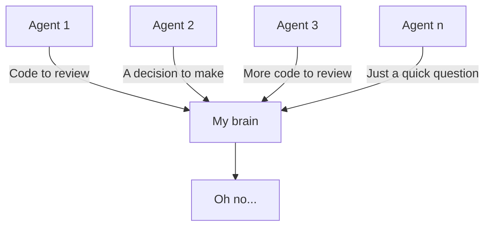

I was looking through an old notebook and found a page that was clearly trying to make sense of how I felt about writing code and how quickly it has changed.

The title on the page was "Why is writing code boring?"

For the record, I don't actually think it's boring. It's just changed.

I don't generally hold strong opinions, it's too tiresome... and I'm mostly wrong anyway. But the speed of this change has been incredible and kind of scary.

<!--more-->

## A different kind of pain

The interesting thing is that this change has happened faster than any other change in my career so far.

My anchor here, I suppose, is virtualisation. There was hype. Everyone said it would make our lives easier. People said it would take our jobs because we wouldn't have to manage n-million physical servers anymore.

But the reality is, we moved with it. Instead, we managed lots of VMs and felt a different kind of pain managing the host servers.

The stuff still existed, but focus shifted a bit.

Maybe that's what's happening now, but much faster?

## Trying to keep up

Thinking back to January 2025, we had AI and it was fine. Agents weren't really an established thing in my workflow yet, and using AI almost had that same feeling as "why would you Google X when it's in this 5,000-page manual on your desk?"

But then agents came, models got more capable and it became harder to get that lasting dopamine effect that I'd get from working through a hard problem.

Now it's more about imagining the thing you want and why you want it, then setting an agent off to do the work for you.

I'm not afraid to admit that often the agents run at a speed that I can't keep up with. And yes, it does make me feel a bit strange, but I think I'm OK with that.

## I still want to build things

I like to imagine problems and possible solutions. I used to only be able to hack on a few of those, but now I can clear that backlog in days and quickly find out what works and what doesn't.

That's the bit I like. There are more ideas I can actually try, even if getting there doesn't feel the same as it used to.

## But man, I'm tired

Don't get me wrong... I'm lucky. I get access to the best models when they are released and can run with them, but man, I'm tired. I think the change maybe is the amount of context I need to deal with, especially when working on n tasks in parallel.

Talking with friends and colleagues in the past, I've described this as the funnel problem... many agents and their output always have to go through one brain eventually.

Maybe "boring" was the wrong word for that notebook page. I still want to build things, and I like how much I can try now. I just haven't worked out how much of it I can keep in my head at once.

... or does that mean that I'm becoming a meat proxy?
