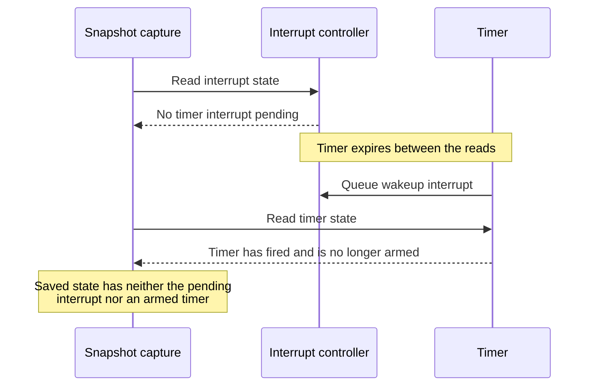

Whilst working on VM snapshots, I came across a Linux guest that would sometimes hang after restore. Serial output stopped, and the guest stayed halted waiting for an interrupt.

It turned out we could lose a timer wakeup while taking the snapshot. We'd stopped the virtual CPUs, but time was still advancing.

<!--more-->

## Capturing timer state

A guest can halt a virtual CPU while it waits for work, then wake up on a timer interrupt. Our guest used a Hyper-V [synthetic timer](https://learn.microsoft.com/en-us/virtualization/hyper-v-on-windows/tlfs/timers) to generate that interrupt.

Our snapshot code read the interrupt controller state and the timer state separately. Stopping the virtual CPU's execution hadn't stopped the timer, so it could expire between those reads:

We'd saved the interrupt controller state before the interrupt arrived, and the timer state after it had fired. The interrupt was pending in the original VM, but missing from the snapshot. After restore, the guest could stay halted unless another interrupt arrived.

## Suspending time

We changed the capture code to wait for all virtual CPU threads and device workers to stop. The virtual CPUs are kept available so we can suspend time and read their state before releasing them.

On Windows Hypervisor Platform, [WHvSuspendPartitionTime](https://learn.microsoft.com/en-us/virtualization/api/hypervisor-platform/funcs/whvsuspendpartitiontime) provides this. It must be called with no virtual processors running. Time resumes when a virtual processor runs again, or when it is explicitly resumed.

We also suspend time in the destination partition during restore, so timers can't expire while we're still installing the saved state.

We check whether the API is available on the host before calling it. Hosts without it keep the previous behaviour and are still affected by this race.

## Reproducing the problem

To reproduce this reliably, we armed a one-shot timer and added a delay between the two reads, long enough for the timer to expire.

With time still advancing, the interrupt was missing after restore. With time suspended, the timer stayed armed throughout the delay and generated its interrupt once the snapshot was restored and time resumed.
