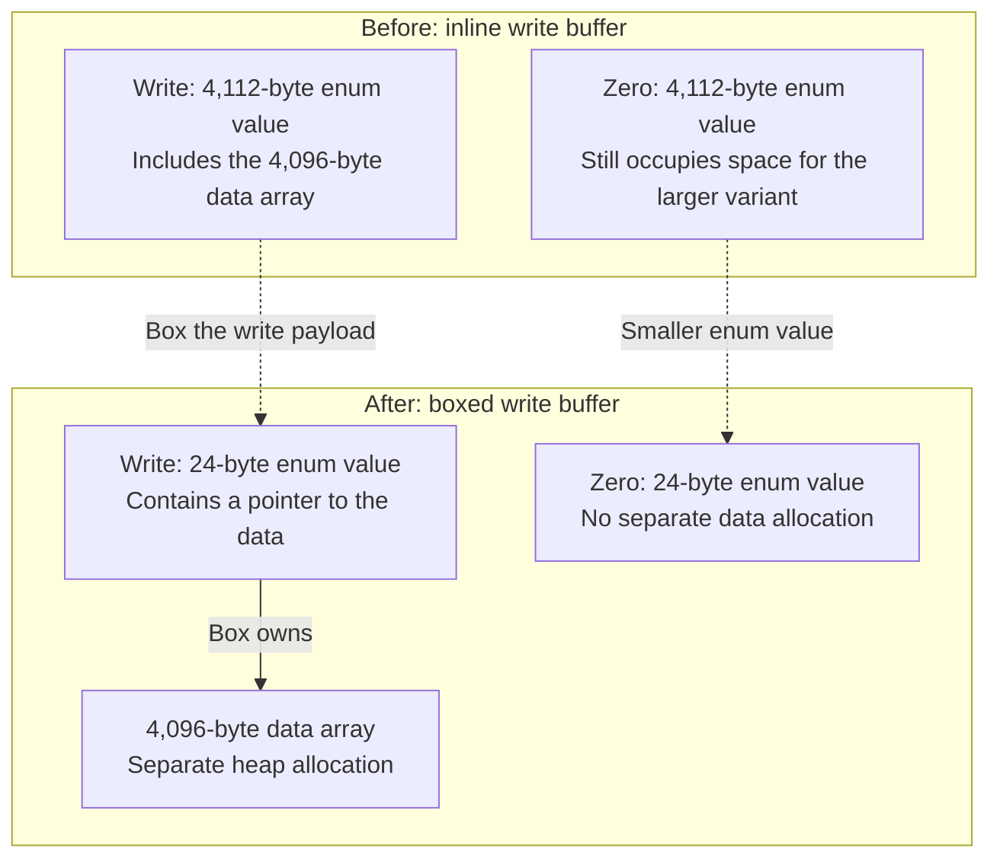

An operation that just described a range to fill with zeroes was taking up more than 4 KiB in our VHDX log replay code.

The replay plan in Docker VMM contains operations to apply to a virtual disk. Some write a sector of data, while others fill a range with zeroes. Both were stored in the same Rust enum, which meant the zero-fill operations took up space for a write buffer they didn't use.

<!--more-->

## Enum size

Here's the original type:

```rust
enum ReplayOp {
    Write { file_offset: u64, data: [u8; 4096] },
    Zero { file_offset: u64, length: u64 },
}
```

The `Write` variant stores its bytes directly inside the enum. Every `ReplayOp` needs enough room for that variant, even when the value is `Zero` and only holds an offset and a length.

In a Windows x64 layout check, [`size_of::<ReplayOp>()`](https://doc.rust-lang.org/std/mem/fn.size_of.html) returned 4,112 bytes. For 4,096 zero-fill operations, that's about 16 MiB for the elements alone. The space for the unused buffer was part of each enum value.

Rust's [default type layout](https://doc.rust-lang.org/reference/type-layout.html#the-rust-representation) can vary between builds, so these exact sizes aren't guaranteed on other compilers or targets.

## Boxing the write buffer

We changed the write buffer to a [Box](https://doc.rust-lang.org/std/boxed/index.html), so only writes need the separate allocation:

```rust
enum ReplayOp {
    Write { file_offset: u64, data: Box<[u8; 4096]> },
    Zero { file_offset: u64, length: u64 },
}
```

The enum now holds a pointer in place of the inline array. In the same layout check, its size dropped to 24 bytes. Those 4,096 zero-fill operations take 96 KiB of element storage.



*Measured Windows x64 layouts, not to scale. Enum sizes include padding; allocator overhead is not shown.*

Each `Write` still needs 4 KiB for its data, now in a separate heap allocation. With this layout, a plan made entirely of writes uses slightly more memory than before, plus allocator overhead. The saving depends on how many zero-fill operations the plan contains.

`size_of` includes padding but doesn't count allocations behind pointers. The figures above only cover the enum values; the plan's total allocation also includes write buffers, spare vector capacity and allocator overhead.

## Empty queues

Our TCP send and retransmit queues also reserved storage before using it. They used `VecDeque::with_capacity` to reserve room for at least eight chunks and 64 segments respectively, even when empty.

For example, [`VecDeque::<u8>::with_capacity(4096)`](https://doc.rust-lang.org/std/collections/struct.VecDeque.html#method.with_capacity) has a length of zero, but reserves room for at least 4,096 bytes. [`VecDeque::<u8>::new()`](https://doc.rust-lang.org/std/collections/struct.VecDeque.html#method.new) starts without a backing allocation.

We switched the queues to `VecDeque::new()` so they allocate when data is added. That moves allocation work to the first use of each queue. Once a queue has grown, emptying it with [`clear()`](https://doc.rust-lang.org/std/collections/struct.VecDeque.html#method.clear) still retains its capacity.
